<div align="center">


<br>


<br><br>

**`BUILD SYSTEMS. AUTOMATE WORK. UNDERSTAND EVERYTHING.`**

</div>

<br>



I'm **Mag**, a developer learning backend engineering in **Go** by building real projects. I care less about code that merely runs and more about understanding *why* it works: the HTTP request, the session, the process, the network underneath.

I write the core logic myself, one project at a time, and move to a new concept only once I understand the last one. The long-term path is **Backend -> Systems -> Cloud Engineering**.

```ini
[now]
building   = Steam Judge        # Flet + Go, Steam OpenID, sessions, rooms, voting
practicing = Wordle in Go       # slices, strings, runes, randomness
studying   = HTTP, REST, auth and sessions, SQL / PostgreSQL
next       = Forge CLI          # Go + Cobra + Bubble Tea
```

<br>


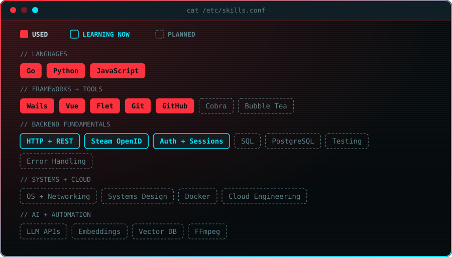

<br>


### `./current`

<p align="center">
  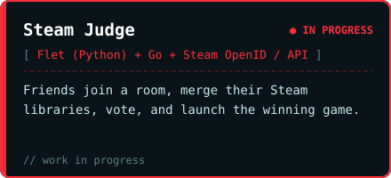
  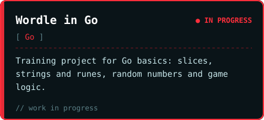
</p>

**Steam Judge** is where I'm learning the full login-to-session flow: how the Steam OpenID login is verified, how the server ties a session to a user, and how the desktop UI talks to the Go API.


### `./shipped`

<p align="center">
  <a href="https://github.com/Magyt71/Orginzer">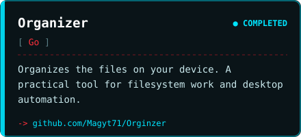</a>
  <a href="https://github.com/Magyt71/GitHub-Finder">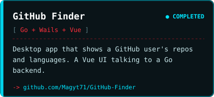</a>
</p>

### `./next`

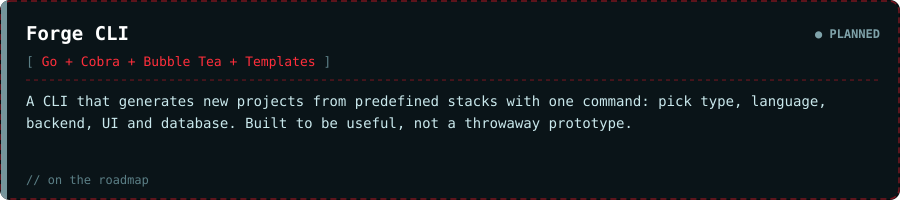


### `./roadmap`

<p align="center">
  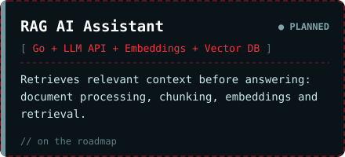
  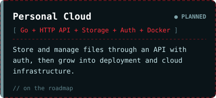
  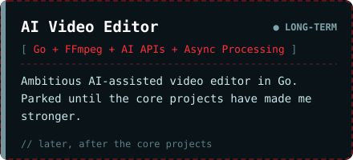
  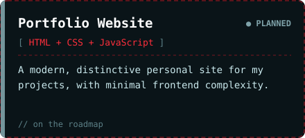
</p>

<details>
<summary><code>ls ./ideas  # kept for later, not started</code></summary>

<br>

| Idea | Tentative stack | What it'd do |
| :-- | :-- | :-- |
| **Repo Archaeologist** | Go, Git | Inspect repositories and understand their structure and Git history. |
| **Process Detective** | Go, OS APIs | Explore running processes and operating-system concepts. |
| **Dead Drop** | Go, Networking, Encryption | A lightweight way to pass messages or files between devices. |
| **Memory Palace** | Go, SQLite | Organize and retrieve information. |
| **Commit Pet** | Go, Git | A fun project tied to development activity. |
| **Command Vault** | Go, CLI, SQLite | Save useful commands and reuse them. |
| **Clipboard Memory** | Go, SQLite, OS APIs | Explore clipboard history and improve workflow. |

*Stacks are not final decisions, and none of these are in progress.*

</details>

<br>



The order is deliberate. **Go fundamentals** first, then **HTTP, REST and authentication**, then **SQL and PostgreSQL**, then testing and error handling. After that comes how systems, networks and processes actually work, then **systems design**, and finally **cloud engineering**, with **Personal Cloud** as the project where it all gets applied. AI and automation run alongside, through projects like the RAG assistant.

<br>


<div align="center">


<br>


<br>


</div>

<br>


```ini
[engineering]
01 = Understand the problem before writing code.
02 = I write the core logic. Tools assist; they don't think for me.
03 = Understand why a technology is needed before adopting it.
04 = Build a working core before adding complexity.
05 = Learn from debugging instead of hiding errors.
06 = Build real things, and be able to explain every decision.
```

<br>


<div align="center">

<a href="https://github.com/Magyt71"></a>
<a href="https://github.com/Magyt71?tab=repositories"></a>
<!--
  Add your own links here, e.g.:
  <a href="https://www.linkedin.com/in/YOUR-HANDLE"></a>
  <a href="mailto:you@example.com"></a>
-->

</div>

<br>

